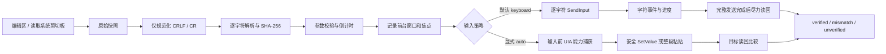

# 自动键盘录入脚本 V2.3

一个面向 Windows 的轻量桌面工具：把原始文本按顺序逐字符模拟键盘输入。V2.3 的核心是真实的 `SendInput` 键盘事件，不是整段复制粘贴。

默认执行路径只有：

```text
读取编辑区原始快照
→ 仅统一 CRLF / CR 为 LF
→ 倒计时
→ 逐字符 SendInput
→ 记录每个字符的事件结果
→ 完成后尽力读取目标用于诊断
```

默认键盘模式不写系统剪贴板、不发送 `Ctrl+V`、不调用 UI Automation `SetValue`，也不会因为目标不可读而放弃逐键输入。整值直写和整段粘贴仍保留，但只能在用户明确选择“整段输入”时使用。

## 功能特点

- 默认逐字符 `SendInput`，中文、英文、数字、标点和 Emoji 都按原始顺序输入。
- 独立解析模块保留空格、Tab、混合空白顺序、空行、行尾空白和末尾换行。
- 只统一 `CRLF/CR → LF`，不裁剪、不重排、不替换正文空白。
- 空格、Tab、换行分别选择实体虚拟键或 Unicode 实验方式。
- 每个字符记录码点、UTF-16 码元、分类、调度方式、请求/接受事件数及按下/松开结果。
- 检测 `SendInput` 部分接受，并尝试释放已经接受的遗留按下事件。
- 失败字符不计入完成数；不会自动重试，也不会回退到粘贴或整值写入。
- 键盘模式输入前不做 UI Automation 捕获；完成后才尽力读回，且不伪造输入前基线。
- 严格区分 `verified`、`mismatch`、`unverified`，不把系统接受事件当成目标内容正确。
- 保留 Tkinter 界面、场景预设、倒计时、字符间隔、进度条、F8 停止、文本分析和日志。
- 仅使用 Python 标准库，无需安装第三方依赖，不包含网络上传功能。

## 运行环境

- Windows 10 / 11。
- Python 3.10 或更高版本，并安装 Tkinter。
- 开发与真实输入验证环境：Windows 11 x64、Python 3.12.9。
- Linux 和 macOS 可以运行文本解析和不依赖 Windows API 的测试，但不能执行真实键盘输入、剪贴板写入或 UI Automation。

## 快速开始

### 双击启动

双击项目中的 [启动工具.bat](./启动工具.bat)，程序通过 `pythonw.exe` 启动，不保留命令行窗口。

### 命令行启动

在项目目录执行：

```bash
python auto_typer.py
```

无需执行 `pip install`。

## 使用方法

1. 打开“自动键盘录入助手 V2.3”。
2. 在“待输入内容”区域直接编辑或按 `Ctrl+V`，也可以点击“读取系统剪切板”。
   - 这里的“读取系统剪切板”只把文本载入工具编辑区，不代表运行时会向目标粘贴。
3. 查看字符统计、空白预览、逐行 `repr` 分析和规范化快照 SHA-256。
4. 保持默认策略“逐字符模拟键盘输入（默认）”。
5. 按目标程序需要选择输入场景，并设置开始前等待和逐键字符间隔。
   - “通用窗口”默认间隔为 20ms，仍可手动设置为 20ms。长代码段如出现字符缺失、符号丢失或换行错误，可调至 30ms 或更慢后重试；间隔只影响速度，不改变字符映射。
6. 默认字符方式为：
   - 空格：实体 `VK_SPACE`；
   - Tab：实体 `VK_TAB`；
   - 换行：真实 Enter / `VK_RETURN`。
7. 打开目标程序，将光标放到输入位置；如需替换，可先选中目标文字。
8. 回到工具点击“运行输入”，在倒计时结束前切换到目标窗口。
9. 查看“实际输入路径与结果验证”和逐字符日志。
10. 如需中止，按 `F8`；工具窗口处于前台时也可以点击“停止输入”。

> 请先在记事本或不含重要内容的编辑器中进行短文本测试。逐键输入会操作当前焦点窗口，真实 Enter 可能触发表单提交、自动缩进或终端命令执行。F8 不能撤销已经发送的键盘事件。

## 输入策略

界面提供两个明确策略：

| 策略 | 用途 | 是否写剪贴板 | 是否调用 SetValue | 是否逐字符 SendInput |
| --- | --- | --- | --- | --- |
| 逐字符模拟键盘输入（默认） | 无法粘贴或需要模拟真实键盘的场景 | 否 | 否 | 是 |
| 整段输入（UI Automation → 剪贴板粘贴） | 明确需要整值写入或整段粘贴时 | 仅粘贴路径 | 可安全直写时 | 否 |

默认键盘策略没有隐藏的粘贴回退。即使目标没有 UI Automation provider、文本不可读或不支持 ValuePattern，也仍会执行逐字符输入。

### 默认字符映射

| 原始字符 | 默认调度 | 请求事件数 | 实验替代 |
| --- | --- | ---: | --- |
| 中文、英文、数字、标点 | UTF-16-LE + `KEYEVENTF_UNICODE` | 每个 BMP 码元 2 个 | 无 |
| Emoji 等补充平面字符 | 两个 UTF-16 代理项，各按下/松开 | 4 个 | 无 |
| 普通空格 `U+0020` | `VK_SPACE` 按下/松开 | 2 个 | Unicode `U+0020` |
| Tab `U+0009` | `VK_TAB` 按下/松开 | 2 个 | Unicode `U+0009` |
| 逻辑换行 `LF` | `VK_RETURN` 按下/松开 | 2 个 | Unicode `U+000A` |

每个 Python 字符的完整事件序列通过一次 `SendInput` 调用提交。Emoji 在进度中算一个 Python 字符，在 Windows 事件层对应两个 UTF-16 码元。

真实记事本 A/B 测试中，Unicode 空格在本机较快间隔下出现过丢失；改为实体 `VK_SPACE` 后，原失败用例及完整语料通过。因此实体空格是当前默认，Unicode 空格保留为实验选项。详见 [Windows 记事本测试报告](./Windows_记事本测试报告.md)。

### 旧逐键兼容选项

勾选“兼容旧逐键模式”后，以上独立选择会被覆盖为：

- Unicode 空格；
- Unicode Tab；
- 真实 Enter。

不勾选时使用 V2.3 的独立默认方式。低层 API 的 `literal_mode=False` 仍表示实体空格、实体 Tab 和真实 Enter，供已有调用方使用。

## 文本保真

运行输入时，程序从编辑区读取一次不可变快照。[text_parser.py](./text_parser.py) 的 `parse_text()` 逐字符扫描内容，唯一文本转换是：

```text
CRLF（\r\n）→ LF（\n）
CR（\r）    → LF（\n）
```

不会对正文整体调用 `strip()`、`lstrip()` 或 `rstrip()`，也不会把空格与 Tab 互换。

解析结果记录：

- 原始文本和规范化文本；
- 规范化文本 SHA-256；
- 每行真实内容、终止符和行号；
- 行首空格数、行首 Tab 数及原始空白顺序；
- 行尾空格、行内 Tab、是否空行、是否末行；
- 总字符数、空格数、Tab 数、换行数、空行数和末尾换行状态。

空内容没有逻辑行；非空文本的行数是换行数加 1。因此 `"A\n"` 会保留第 1 行 `"A"` 和第 2 行空字符串，不会折叠末尾换行。

## 实际执行路径



默认键盘路径中：

- 输入前没有 `TargetController.capture()`；
- 没有剪贴板备份、写入或恢复；
- 没有 `Ctrl+V`；
- 没有 `ValuePattern.SetValue`；
- 没有 Shift+Tab、Backspace、Home/End 等事后清理按键；
- 每次换行后至少等待 50 毫秒，让目标处理事件，不发送额外缩进键。

## 逐字符诊断

每个字符成功后记录以下事实；失败时也会记录失败位置和原因：

| 字段 | 含义 |
| --- | --- |
| `position` | 从 1 开始的 Python 字符位置 |
| `character_repr` | 字符的 `repr`，可区分空格、Tab 和换行 |
| `codepoints` | Unicode 码点 |
| `utf16_units` | UTF-16-LE 码元 |
| `kind` | `printable`、`space`、`tab` 或 `newline` |
| `method` | `unicode`、`vk_space`、`vk_tab`、`vk_return`、`unicode_tab` 或 `unicode_lf` |
| `requested` / `accepted` | 本字符请求和系统接受的输入事件数 |
| `key_down_success` | 所有请求的按下事件是否被接受 |
| `key_up_success` | 完整事件序列是否被接受 |
| `status` | `sent` 或 `failed` |
| `error` | 失败原因 |

终端事件还包含：

- 原始快照 SHA-256；
- 总字符数、空格、Tab、换行、空行和最大连续空行；
- 行数和末尾换行状态；
- 实际完成字符数；
- 当前行、原始缩进和实际发送计数；
- 失败字符位置；
- 前台窗口/焦点是否保持；
- 目标读回状态；
- 最近 200 条内部诊断。

字符事件在终端 JSON 中最多保留 5000 条，但 `character_event_count` 始终记录真实总数，截断数量单独报告。

## 部分发送与失败处理

`SendInput` 的返回值必须等于请求事件数。若只接受了前缀：

1. 保留原始 Windows 错误；
2. 识别已经接受的按下事件；
3. 按相反顺序尝试发送对应的松开事件；
4. 记录清理是否成功；
5. 抛出结构化 `SendInputError`；
6. 当前字符不计入完成数，任务停止。

`key_down_success=True` 只表示所有按下事件被接受，不代表整个字符成功；只有 `key_up_success=True` 且接受数等于请求数，才记录为 `sent`。

失败后不会自动重试，也不会改用整段粘贴或 SetValue，以避免重复输入或扩大影响。

## 验证边界

### 三层证据

| 层级 | 证明内容 | 不能单独证明什么 |
| --- | --- | --- |
| 文本解析层 | 原文除换行规范化外被逐字符保留，可无损重建 | 目标最终得到什么文本 |
| 事件提交层 | 每个字符的 SendInput 序列、接受数量和顺序符合设计 | 目标是否接收、转换或丢弃输入 |
| 目标结果层 | 控件读回或隔离保存文件与预期完整逻辑文本一致 | 富文本格式、业务语义、撤销栈和所有未知程序行为 |

### 状态含义

| 状态 | 含义 |
| --- | --- |
| `verified` | 完整目标逻辑文本与预期一致，且验证方法有足够基线 |
| `mismatch` | 目标可读，但完整结果与预期存在差异 |
| `unverified` | 目标不可读、基线不足、提前停止或无法完成比较 |

默认键盘模式为了在输入前避免不必要的 UIA 捕获，没有保存目标前缀、后缀和选区基线。因此，非空目标即使事后读回与输入快照相同，也不能证明原有前后缀和选区被正确处理；worker 会诚实返回 `unverified`，读回比较只作为诊断。

可读空目标可以用完整输入快照作为预期结果，这是有限的验证特例。真实记事本测试另行通过隔离 UTF-8 文件和保存后比较取得目标层证据；该外部验证不会篡改 worker 的 `unverified` 状态。

## 测试

### 单元测试

```bash
python -m unittest -v
```

当前共 105 项测试：

| 测试类别 | 数量 |
| --- | ---: |
| `TextParserTests` | 17 |
| `TextComparisonTests` | 5 |
| `CharacterDispatchTests` | 13 |
| `TypeTextTests` | 20 |
| `TargetCursorTests` | 4 |
| `InputWorkerTests` | 28 |
| `ClipboardApiTests` | 4 |
| `ClipboardPlatformTests` | 1 |
| `WindowsInputStructureTests` | 12 |
| `HiddenUiTests` | 1 |
| **合计** | **105** |

测试覆盖换行规范化、逐行空白、Emoji 代理项、默认与实验字符方式、部分发送清理、失败不计进度、停止、并发互斥、禁止隐式回退、剪贴板模拟、UIA 模拟、前台焦点为空和隐藏界面构建。

### 语法检查

```bash
python -m py_compile auto_typer.py text_parser.py clipboard_text.py target_text.py test_auto_typer.py notepad_validation.py
```

### 真实 Windows API 检查

真实记事本验证会检查 x64 ABI：

- `INPUT = 40` 字节；
- `INPUT_UNION = 32` 字节；
- `KEYBDINPUT = 24` 字节；
- `INPUT.data` 偏移为 8；
- `KEYBDINPUT.dwExtraInfo` 偏移为 16。

这些检查只证明本机结构布局与 API 调用前提正确，不等于目标内容验证。

### 真实记事本验证

```bash
PYTHONIOENCODING=utf-8 python notepad_validation.py --interval-ms 20
```

验证脚本使用生产 `input_worker()` 和真实 `SendInput`，在隔离记事本窗口中输入 17 类语料，另存为 UTF-8 后逐字符、逐行比较。脚本会 fail-fast 禁止默认键盘路径调用剪贴板、粘贴和 UIA 控制器。

2026-11-26 的最终结果：

- 第一轮完整语料：17/17 通过；
- 第二轮完整语料：17/17 通过；
- 每轮 511 个 Python 字符、1024 个键盘事件；
- 每轮所有生产路径检查、保存文件精确比较和逐行比较均通过。

完整方法、失败对照和证据链接见 [Windows 记事本测试报告](./Windows_记事本测试报告.md)。

## 已知限制

- 真实目标证据来自本机 Windows 11 记事本，不代表所有代码编辑器、网页、终端或远程桌面。
- 逐键 Enter 仍可能触发目标自动缩进、自动补全、格式化或命令执行；工具不会用固定 Shift+Tab 或 Backspace 掩盖结果。
- 实体 Tab 在对话框中可能移动焦点；Unicode Tab 也不能保证被所有目标接受。
- 间隔过短（尤其长代码段）容易出现字符缺失、符号丢失或换行错误；可调至 30ms 或更慢。20ms 仍保留，但不保证所有目标都能承受同样速度。
- 自定义绘制控件、游戏、安全软件和管理员权限目标可能拦截输入。
- 锁屏、UAC 和安全桌面不允许普通自动化操作。
- 远程桌面、虚拟机可能延迟或转换键盘与剪贴板事件。
- 富文本格式、业务事件、撤销栈和并发编辑不在当前文本比较范围内。
- NUL 在运行前被拒绝；无法编码为 UTF-16 的孤立代理项会报错，不会被静默删除。

如果保存文件或控件读回出现 `mismatch`，应保留逐行差异和运行日志，再判断是目标过滤、格式化、焦点变化还是时序问题。不要用删除空格、转换 Tab 或额外换行掩盖差异。

## 项目结构

```text
.
├── auto_typer.py                 # 界面、逐字符调度、SendInput、诊断与停止
├── text_parser.py                # 无损解析、逐行记录、重建与比较
├── clipboard_text.py             # 仅显式整段策略使用的 Unicode 剪贴板模块
├── target_text.py                # 仅显式整段策略使用的 UIA 捕获、直写与读回
├── test_auto_typer.py            # 105 项单元与 Windows 结构测试
├── notepad_validation.py         # 真实 Windows 记事本验证脚本
├── Windows_记事本测试报告.md      # 真实目标方法、结果、失败对照与限制
├── README.md                     # V2.3 使用与机制说明
├── V2.3_修改说明.md              # V2.2 审查、V2.3 改动与测试依据
├── V2.2_修改说明.md              # V2.2 历史说明
├── V2.1_修改说明.md              # V2.1 历史说明
├── V2.0_修改说明.md              # V2.0 历史说明
├── 启动工具.bat                  # Windows 双击启动脚本
└── validation_results/           # 真实记事本运行 JSON 与保存文件
```

## 安全使用

请仅在你有权操作的本机程序、自己的远程桌面、测试环境或教学演示中使用。

不要用于验证码绕过、未授权批量操作、规避安全策略或违反目标系统规则的行为。终端场景应特别确认逐字符 Enter 是否会立即执行命令。工具不会主动上传文本，但默认键盘输入会直接操作当前焦点窗口。

## 技术参考

- [SendInput](https://learn.microsoft.com/en-us/windows/win32/api/winuser/nf-winuser-sendinput)
- [KEYBDINPUT](https://learn.microsoft.com/en-us/windows/win32/api/winuser/ns-winuser-keybdinput)
- [GetGUIThreadInfo](https://learn.microsoft.com/en-us/windows/win32/api/winuser/nf-winuser-getguithreadinfo)
- [IUIAutomationValuePattern::SetValue](https://learn.microsoft.com/en-us/windows/win32/api/uiautomationclient/nf-uiautomationclient-iuiautomationvaluepattern-setvalue)
- [Clipboard Functions](https://learn.microsoft.com/en-us/windows/win32/dataxchg/clipboard-functions)
