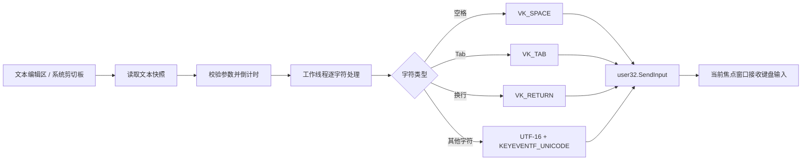

# 逐字输入助手

一个面向 Windows 的轻量桌面工具：把文本逐个字符模拟成真实键盘输入，用于那些不支持粘贴、但允许键盘录入的场景。

它不发送 `Ctrl+V`，也不修改系统剪切板；中文、英文、空格、Tab 缩进和换行会按照各自对应的键盘事件输入到当前焦点窗口。

## 功能特点

- 支持直接粘贴文本，或一键读取系统剪切板。
- 使用 Windows `SendInput` 模拟键盘按下与松开。
- 中文、英文、标点和 Emoji 按 Unicode 字符输入，不依赖当前输入法。
- 空格、Tab、换行分别使用空格键、Tab 键和 Enter 键，避免被合并或误删。
- 提供空白可视化检查，清楚显示行尾空格、连续空格、Tab 和换行。
- 内置通用窗口、代码编辑器、网页输入框、终端、远程桌面等场景预设。
- 支持开始前倒计时、字符间隔调节、进度显示和 F8 全局停止。
- 仅使用 Python 标准库，无需安装第三方依赖。

## 运行环境

- Windows 10 / 11。
- Python 3.10 或更高版本，并安装 Tkinter。
- 当前版本已在 Windows 11 x64、Python 3.12.9 下验证。
- 暂不支持 macOS 和 Linux。

## 快速开始

### 方式一：双击启动

双击项目中的 [启动工具.bat](./启动工具.bat)，程序会通过 `pythonw.exe` 启动，启动后不保留命令行窗口。

### 方式二：命令行启动

在项目目录执行：

```bash
python auto_typer.py
```

无需执行 `pip install`。

## 使用方法

1. 打开“逐字输入助手”。
2. 在“待输入内容”区域按 `Ctrl+V` 粘贴文本，或点击“读取系统剪切板”。
3. 查看内容统计和“空白与缩进检查”：
   - `·` 表示一个空格；
   - `→` 表示一个 Tab；
   - `↵` 表示一个换行。
4. 选择“输入场景”。场景会应用对应的等待时间、字符间隔和注意事项。
5. 根据需要调整：
   - 开始前等待：`0–60` 秒；
   - 字符间隔：`0–1000` 毫秒。
6. 打开目标程序，将光标放到需要输入的位置。
7. 回到工具点击“运行输入”，在倒计时结束前切换到目标窗口。
8. 等待输入完成。如果需要中止，随时按 `F8`；工具窗口处于前台时，也可以点击“停止输入”。

> 建议先使用记事本或文本编辑器做一次短文本测试，再用于正式场景。

## 场景预设

| 场景 | 开始前等待 | 字符间隔 | 适用情况 |
| --- | ---: | ---: | --- |
| 通用窗口 | 5 秒 | 20 毫秒 | 文本编辑器等大多数多行输入区域 |
| 代码编辑器 | 5 秒 | 15 毫秒 | 代码、配置、脚本等需要保留缩进的内容 |
| 网页输入框 | 5 秒 | 25 毫秒 | 禁止粘贴但仍接受键盘输入的表单或编辑器 |
| 终端 / 命令行 | 5 秒 | 40 毫秒 | 命令、路径、配置参数等终端录入 |
| 远程桌面 / 虚拟机 | 7 秒 | 80 毫秒 | 剪切板同步不可用或输入响应较慢的远程环境 |

场景预设只改变速度和提示，不会改写文本内容。所有场景都遵循相同的空格、Tab、换行和 Unicode 输入规则。

## 底层原理

### 1. 文本快照与换行规范化

点击“运行输入”后，程序从文本编辑区读取一份内容快照，并暂时锁定编辑区和参数，避免输入过程中内容发生变化。

Windows 剪切板中的换行通常使用 `CRLF`。如果直接把 `\r` 和 `\n` 都发送为 Enter，可能产生两次换行，因此程序只做一项规范化：

```text
CRLF（\r\n）→ LF（\n）
CR（\r）    → LF（\n）
```

随后，每个逻辑换行发送一次 Enter。空格数量、Tab 数量、行尾空格以及中英文内容不会被裁剪或重新排版。

### 2. 不同字符使用不同键盘事件

| 原文字符 | 输入方式 | Windows 按键 |
| --- | --- | --- |
| 普通空格 ` ` | 虚拟键按下、松开 | `VK_SPACE` |
| Tab `\t` | 虚拟键按下、松开 | `VK_TAB` |
| 换行 `\n` | 虚拟键按下、松开 | `VK_RETURN` |
| 中文、英文、标点、Emoji 等 | Unicode 键盘事件 | `KEYEVENTF_UNICODE` |

普通空格不使用 Unicode 空格事件，而是发送真实的空格键事件；Tab 和 Enter 也使用实体虚拟键。这样更接近用户手动敲击键盘的行为。

### 3. Unicode 输入与 Emoji

中文、英文和标点通过 Windows `SendInput` 的 `KEYEVENTF_UNICODE` 事件输入。每个字符先转换为 UTF-16-LE 码元，再分别发送“按下”和“松开”事件。

对于 Emoji 等补充平面字符，一个字符会占两个 UTF-16 码元，即一对代理项。程序会依次发送这两个码元，而不是只发送其中一半。

这种方式不依赖当前键盘布局或输入法状态，适合中英文混合内容。

### 4. 输入流程



### 5. 停止与界面刷新

输入在独立工作线程中执行，避免阻塞界面。工作线程通过队列向主线程发送倒计时、进度、完成和错误信息，主线程再更新界面。

程序使用 `threading.Event` 和 `GetAsyncKeyState(VK_F8)` 检测停止请求。由于 F8 不要求工具窗口保持前台，因此切换到一个全屏目标程序后也可以停止输入。

### 6. 错误处理

每次调用 `SendInput` 后，程序都会检查系统实际接收的事件数量。如果数量不足，会显示错误并保留已输入的字符进度。

## 典型应用场景

- **旧版客户端软件**：支持键盘输入，但没有粘贴入口或粘贴按钮失效。
- **远程桌面与虚拟机**：本地与目标系统之间无法使用剪切板同步。
- **网页表单**：页面仅禁止粘贴，但仍允许正常键盘录入。
- **代码与配置录入**：需要原样保留缩进、行尾空格和中英文注释。
- **重复模板填写**：在获得授权的本地环境中录入固定格式、测试文本或演示内容。
- **教学与操作演示**：以较慢速度展示逐字录入过程。

## 兼容性与注意事项

键盘事件由目标程序最终处理，因此工具能够保证的是“发送了什么事件”，不能保证所有目标程序都以完全相同的方式解释这些事件。

- **自动缩进、自动补全、自动配对**：可能改变最终文本。录入代码时建议先关闭这些功能。
- **网页单行输入框**：Enter 可能提交表单，而不是换行。多行内容应聚焦到多行编辑区。
- **终端 Tab 补全**：Tab 可能触发补全，而不是插入制表符。
- **远程软件**：目标端必须支持键盘事件；部分远程协议可能过滤或延迟事件。
- **管理员权限程序**：Windows 会限制低权限进程向高权限程序发送输入。若目标程序以管理员身份运行，本工具也需要以管理员身份运行。
- **安全桌面与受保护界面**：不能用于锁屏、UAC 安全桌面等系统保护界面。
- **游戏与安全软件**：部分游戏、反作弊系统或安全软件可能阻止模拟输入。
- **输入法与自动纠错**：Unicode 事件不依赖输入法，但目标程序自身的输入法处理、自动纠错或文本过滤仍可能影响结果。

如果出现漏字，可以适当增大字符间隔；如果 Tab 移动了焦点或 Enter 提交了表单，应更换目标输入区域或选择更合适的场景。

## 常见问题

### 为什么中文能够直接输入，不需要切换输入法？

中文通过 `KEYEVENTF_UNICODE` 事件发送，不经过输入法候选过程。空格、Tab 和 Enter 使用对应的实体按键。

### 为什么会把行尾空格保留下来？

程序不会调用 `strip()` 或压缩空白。读取文本时只规范化换行符，其他字符保持原样；“空白与缩进检查”可以帮助确认行尾空格。

### Windows 换行会不会输入两次 Enter？

不会。`CRLF` 会先规范化成一个 `\n`，再发送一次 Enter，避免把回车和换行分别处理成两次按键。

### 为什么目标程序没有任何反应？

请依次检查：

1. 倒计时结束时，目标窗口是否确实处于前台；
2. 光标是否位于可接收键盘输入的编辑区；
3. 目标程序是否以管理员权限运行；
4. 目标程序是否主动拦截模拟输入；
5. 字符间隔是否过小，导致目标来不及处理。

### 如何停止输入？

按 `F8` 即可停止。如果工具窗口仍在前台，也可以点击“停止输入”。

### 工具会读取或上传我的文本吗？

程序只在本地内存中处理文本，不包含网络请求，不会主动上传内容。读取系统剪切板时只获取文本，不会改写剪切板。

## 安全使用说明

请仅在你有权操作的本机程序、自己的远程桌面、测试环境或教学演示中使用。

不要用于验证码绕过、未授权批量操作、规避网站或软件安全策略，以及任何违反当地法律或目标系统使用规则的行为。使用终端场景前应特别确认 Enter 是否会执行命令。

## 项目结构

```text
.
├── auto_typer.py       # 界面、输入引擎、场景预设与任务调度
├── test_auto_typer.py  # 输入引擎单元测试
├── 启动工具.bat        # Windows 双击启动脚本
└── README.md          # 项目说明文档
```

## 开发与测试

运行单元测试：

```bash
python -m unittest -v
```

检查语法：

```bash
python -m py_compile auto_typer.py test_auto_typer.py
```

测试覆盖以下内容：

- `CRLF`、`CR`、`LF` 的换行规范化；
- 中文与 Emoji 的 UTF-16 码元拆分；
- 空格、Tab、换行与普通字符使用不同输入事件；
- 中英文、空格、Tab、换行的内容统计；
- 空白可视化标记。

进行真实输入测试时，建议使用记事本或空白文本编辑器，不要直接在重要文档、生产终端或正在填写的重要表单中测试。
